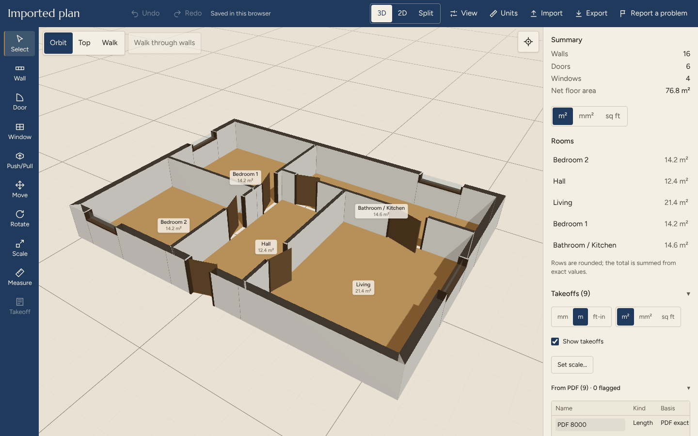
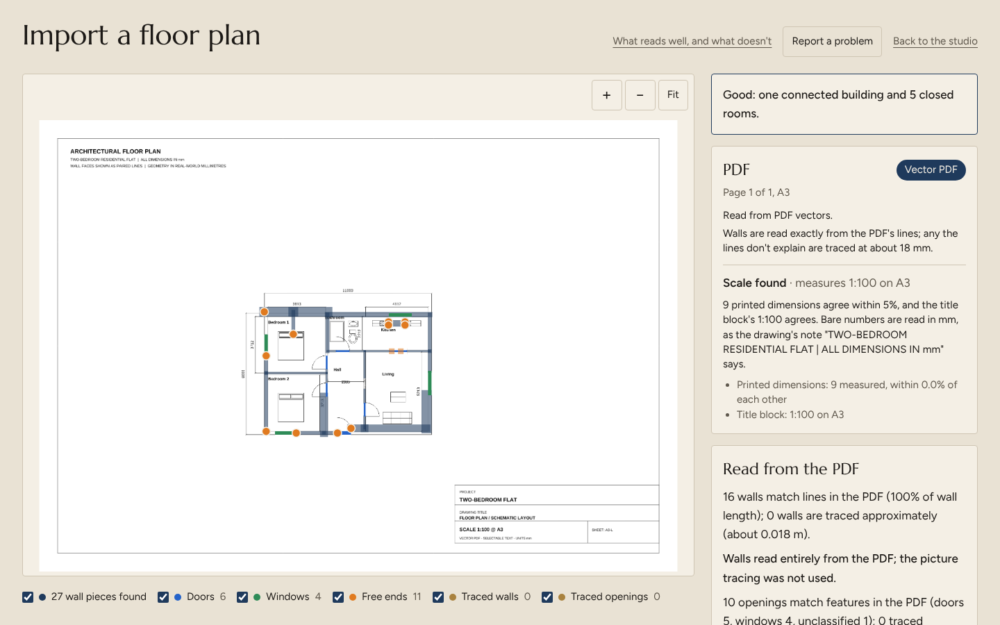
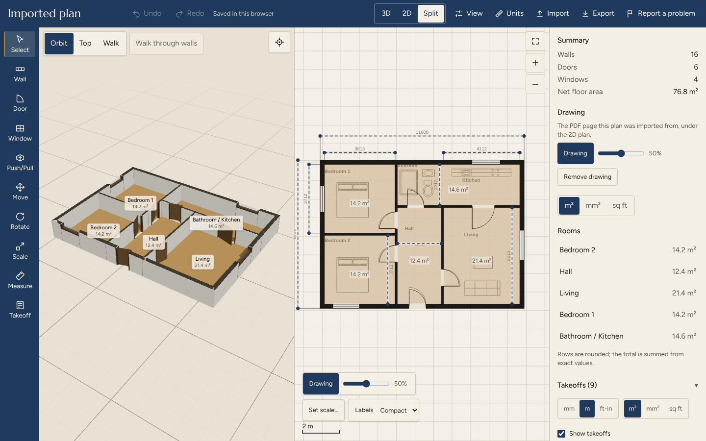
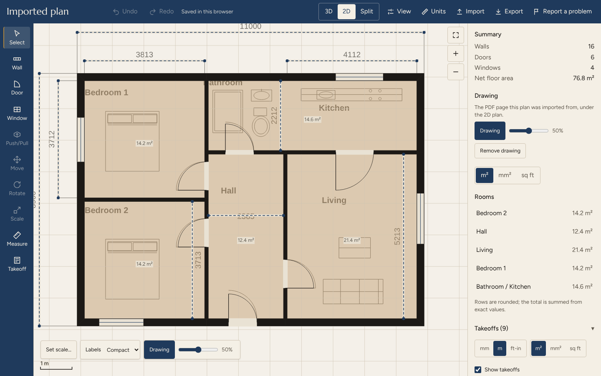
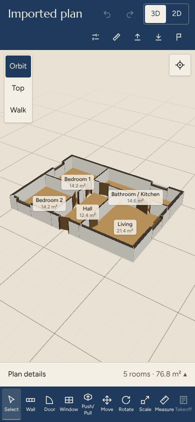
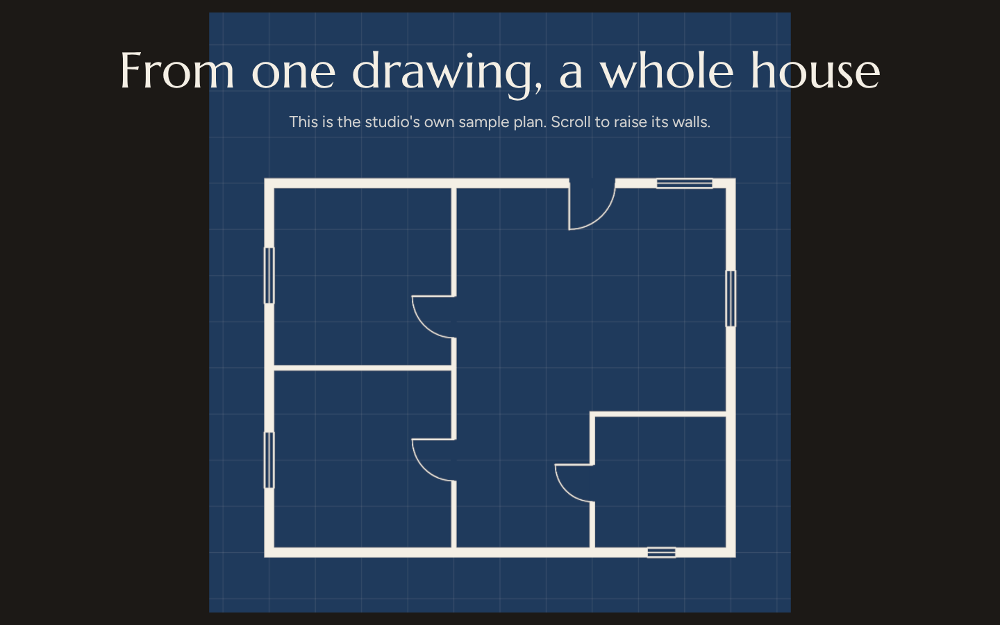
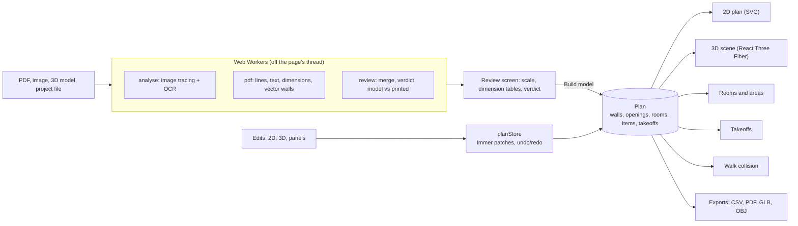

<div align="center">

# Atrium

**Turn a floor plan into an editable 3D model, in your browser. Your files never leave it.**

[](https://github.com/RachitMittal-20/Atrium-v2/actions/workflows/ci.yml)
[](https://atrium-v2-ashen.vercel.app/)


[**Live demo**](https://atrium-v2-ashen.vercel.app/) · [Architecture](docs/ARCHITECTURE.md) · [Case study](docs/case-study-arrowhead-scale.md) · [What it can't do](src/app/limits/page.tsx)



</div>

Atrium reads a vector PDF or an image of a floor plan, works out the walls, doors, windows, rooms and scale, and builds a model you can edit in 2D and 3D, measure, walk through and export. Nothing is uploaded: reading, editing and exporting all run in your browser tab.

It is a portfolio project, built by one person with Claude Code. It is a working tool with honest limits, not a finished product.

## Screenshots

| Import review | Studio, 3D and 2D side by side |
| --- | --- |
|  |  |
| The review judges the plan before you build it: scale, dimensions and a verdict (Good, Check or Not usable). | The original PDF sits under the 2D plan. Rooms, areas and takeoffs come from the same plan. |

| 2D plan with dimension takeoffs | Export menu |
| --- | --- |
|  |  |
| Printed dimensions from the PDF become checked takeoffs. | Everything is made in the browser and downloaded directly. |

| On a phone (390 px wide) | Landing page |
| --- | --- |
|  |  |
| The studio is built to stay usable at 390 px. | The sample plan rises into 3D as you scroll. |

The screenshots show a **synthetic** two-bedroom plan (`tests/fixtures/pdf/plan-chatgpt-flat.pdf`, generated with ChatGPT, not a real CAD file), taken from the live site.

## What makes it different

- **It checks its own work.** The review lists every printed dimension it matched, what the model measures at the scale in use, and whether they agree. A plan verdict says Good, Check or Not usable *before* you build, with reasons. Plans it can't read say so instead of producing a plausible wrong model.
- **Vector first.** From a vector PDF, walls come from the drawing's own lines and scale from its printed dimensions, not from guessing pixels. Image tracing is the fallback, and every wall says which one it came from.
- **One source of truth.** Everything is derived from a single `Plan` object, so 2D, 3D, room areas, takeoffs and exports can't disagree.
- **Private by design.** No server code and no third-party requests. OCR, PDF reading and fonts are self-hosted. (This is not an offline app: there is no service worker.)
- **Written to fail first.** Each reader rule is a general drawing convention proven on its own synthetic fixture, never tuned to one file. See the [case study](docs/case-study-arrowhead-scale.md).

## Features

| Area | What you get |
| --- | --- |
| **Import** | Vector PDF, scanned PDF, or image. Scale from printed dimensions, title block or room labels, or type one wall's length. |
| **Review** | Dimension check with overrides, plan verdict, coverage report, what was left out and why. |
| **Edit** | Draw walls, place doors and windows, drag walls and ends, type exact lengths, undo and redo. |
| **3D editing** | SketchUp-style Push/Pull for wall height, thickness, door and window faces. Move, Rotate and Scale. |
| **Views** | Orbit, Top and Walk. A cutaway at 1.2 m so imported plans don't look cramped, and room names in 3D. |
| **Takeoffs** | Lengths and areas with cutouts, in mm, m or ft-in, snapping to the original PDF's lines, CSV download, and a Set scale tool. |
| **Walkthrough** | Keyboard or touch, stopped by walls, with an optional walk-through-walls mode. |
| **3D models** | Import GLB, glTF, OBJ, FBX, DAE, STL, 3DS or a zip, then move parts. Stored in your browser only. |
| **Save and export** | `.atrium.json` project files, area schedule CSV, PDF report, GLB and OBJ. |

## How it works



1. **Read.** A worker extracts every painted line and text item from the PDF, matches dimension text to the lines it measures, and works out the scale. Walls come from face pairs, filled rectangles or single thick strokes; doors from swing arcs; windows from glazing lines.
2. **Review.** The reading is merged with a picture trace only where the PDF's own lines don't explain a wall. The review scores the result and shows the evidence.
3. **Build.** One click turns the reading into a `Plan`, in metres.
4. **Edit and derive.** Every edit goes through one store; 2D, 3D, areas, takeoffs and exports are views of the plan. Selection, tools, camera and units are view state and are never saved in it.

More in [`docs/ARCHITECTURE.md`](docs/ARCHITECTURE.md) (module map, rules, weak spots).

## Who it's for

- **Students and hobbyists** who want to see a floor plan as a 3D space, or learn how plans are structured.
- **Designers and small teams** who need quick quantities, such as wall lengths and room areas, from a PDF without opening CAD.
- **Developers** interested in how a browser can read vector PDFs, build a 3D model and stay private.

It is not for construction documents, structural work or anything you would sign off. Treat the output as a first draft you check.

## Honest limits

The full text is shown at `/limits` in the app.

- The reader is tested on synthetic drawings and a few real plans, not a wide range of real CAD files. Expect surprises. One real house plan still reads "Not usable".
- Diagonal and curved walls are mostly missed, and openings in them are not read.
- Scans and photos with no dimensions have no scale until you type one wall's length.
- Sliding, bi-fold, pocket, revolving and arched doors can be missed or misread.
- Furniture, stairs and hatching drawn as lines can be taken for walls. The review lists what it left out, but it can be wrong.
- Heights are defaults (walls 2.7 m, doors 2.1 m, windows 1.2 m on a 0.9 m sill) until you change them.
- One floor at a time. No furniture or finishes catalog.
- Not tested on a real phone, Safari or Firefox.

## Coming soon

Planned, in no firm order, and not promises:

- A catalog of furniture and auto-furnish
- Realistic rendering
- Reading SketchUp (`.skp`) and 3ds Max (`.max`) files
- Design options and share links
- A depth-parallax landing scene and a construction-site scene
- Proving the PDF reader on more real plans

## Tech stack

Next.js 16 (App Router), React 19, TypeScript (strict), Tailwind 4, React Three Fiber and drei on three.js, GSAP with ScrollTrigger and Lenis (landing page), Zustand with Immer, pdf.js, tesseract.js and pdf-lib. One Next.js app, no server code, deployed on Vercel's free tier.

## Run it locally

You need the Node version in [`.nvmrc`](.nvmrc) (24.14.0).

```bash
npm ci
npm run dev    # http://localhost:3000
npm test
```

## Tests

- **CI** ([`ci.yml`](.github/workflows/ci.yml)) runs on every push and pull request: `npm ci`, `npm test`, `tsc --noEmit`, lint (non-blocking), `npm run build`, then greps of the production bundle for dev-only hooks and CDN URLs. Either grep finding something fails the job.
- **`npm test`** chains `tsx` scripts in `scripts/test-*.ts`: pure logic, the PDF reader on fixtures, stores, project files and guards.
- **Browser suites run locally only.** The `scripts/e2e-*.ts` suites need a dev server and Playwright's Chromium, and are not in CI because they have not been shown reliable on a clean runner.

## Credits and licences

Released under the [MIT licence](LICENSE). Every direct dependency, its version and its licence are in [`THIRD_PARTY.md`](THIRD_PARTY.md).

- **Fonts:** Marcellus and Figtree, self-hosted in `src/app/fonts/` under the SIL Open Font License ([Marcellus](src/app/fonts/OFL-Marcellus.txt), [Figtree](src/app/fonts/OFL-Figtree.txt)).
- **tesseract.js** and tesseract.js-core with the English `best_int` data, served from `public/tesseract/` ([licences](public/tesseract/LICENSES.md)).
- **pdf.js**, whose image-decoder WebAssembly is served from `public/pdfjs/wasm/` with its licences.
- **three.js**, react-three-fiber and drei.
- Blueprint detection and the smooth-scroll provider come from [Atrium v1](https://github.com/RachitMittal-20/Atrium).
- **Landing page photographs:** AI-generated images, illustrative, not Atrium output.
